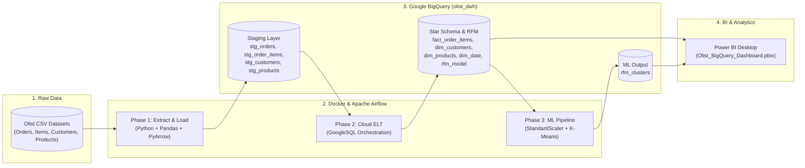
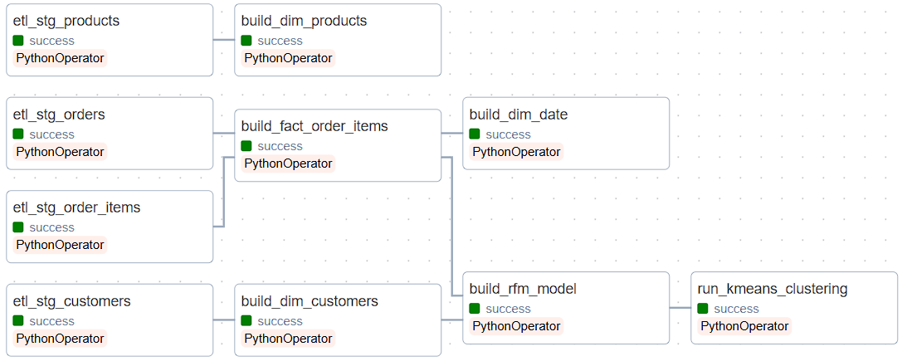
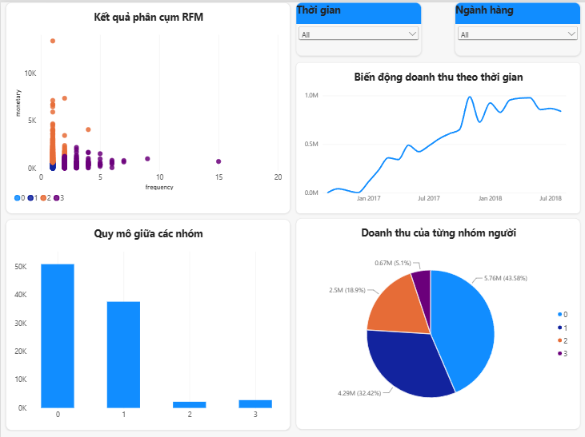

# End-to-End E-Commerce Data Pipeline & Customer Segmentation


## 1. Tổng quan dự án (Project Overview)

Dự án xây dựng một hệ thống **ELT Data Pipeline khép kín (End-to-End)** xử lý dữ liệu thương mại điện tử **Olist Brazilian E-Commerce** (~100.000 đơn hàng), kết hợp mô hình hóa kho dữ liệu chuẩn **Star Schema**, phân cụm khách hàng bằng **Machine Learning (RFM + K-Means)** và trực quan hóa báo cáo quản trị trên **Power BI**.

### Quá trình nâng cấp kiến trúc (System Evolution)
* **Phiên bản 1.0 (Local MVP):** Xử lý ETL cục bộ bằng Python scripts, lưu trữ trên **SQL Server** và kết nối Power BI (`Project Dashboard.pbix`).
* **Phiên bản 2.0 (Modern Data Stack trên Cloud):** Chuyển đổi sang kiến trúc **ELT hiện đại** — đóng gói môi trường bằng **Docker Compose**, điều phối tự động 10 tác vụ bằng **Apache Airflow**, đẩy toàn bộ khối lượng tính toán biến đổi dữ liệu sang **Google BigQuery** và xuất báo cáo trực tiếp từ Cloud (`Olist_BigQuery_Dashboard.pbix`).

---

## 2. Kiến trúc hệ thống (System Architecture)

Luồng dữ liệu được điều phối tự động mỗi ngày (`@daily`) thông qua DAG **`olist_to_bigquery_pipeline`** gồm 3 pha xử lý chính:


---


## 3. Thiết kế Kho dữ liệu & Mô hình phân cụm (Data Modeling & ML)

### Mô hình Star Schema trên BigQuery (`olist_dwh`)
| Tên bảng | Loại bảng | Mô tả chi tiết |
| :--- | :--- | :--- |
| **`fact_order_items`** | Fact Table | Lưu trữ chi tiết từng sản phẩm trong mỗi đơn hàng thành công (`price`, `freight_value`, `order_purchase_date`, cùng các khóa ngoại `product_id`, `customer_id`, `seller_id`). |
| **`dim_customers`** | Dimension | Thông tin định danh và khu vực địa lý của khách hàng (`customer_id`, `customer_unique_id`, `customer_city`, `customer_state`, `customer_zip_code_prefix`). |
| **`dim_products`** | Dimension | Thuộc tính sản phẩm (`product_id`, `product_category_name`, kích thước và trọng lượng). |
| **`dim_date`** | Dimension | Bảng chiều thời gian chuẩn hóa theo ngày (`date_key`, `year`, `quarter`, `month`, `day`, `weekday`). |
| **`rfm_clusters`** | Mart / ML Table | Bảng tổng hợp 3 chỉ số **Recency** (số ngày từ lần mua gần nhất), **Frequency** (tần suất mua), **Monetary** (tổng chi tiêu) kèm nhãn cụm `cluster` (0–3). |

---

## 4. Cấu trúc thư mục (Repository Structure)

```text
ecommerce-data-pipeline/
├── dags/
│   └── olist_to_bigquery_dag.py      # DAG chính điều phối 10 tác vụ ELT & K-Means trên Airflow
├── docs/
│   ├── airflow_dag_graph.png         # Ảnh chụp luồng chạy xanh 10 tasks trên Airflow UI
│   └── powerbi_dashboard.png         # Ảnh chụp giao diện báo cáo Power BI kết nối BigQuery
├── docker-compose.yaml               # Cấu hình cụm Airflow (Webserver, Scheduler, Worker, Postgres, Redis)
├── Olist_BigQuery_Dashboard.pbix     # Dashboard Power BI v2.0 kết nối trực tiếp Google BigQuery
├── Project Dashboard.pbix            # Dashboard Power BI v1.0 (Local SQL Server MVP)
├── etl_pipeline.py                   # Script ETL phiên bản Local v1.0
├── ml_rfm_clustering.py              # Script phân cụm K-Means phiên bản Local v1.0
├── SQLQuery1.sql ... SQLQuery6.sql   # Các truy vấn T-SQL xây dựng DWH phiên bản Local v1.0
├── .gitignore                        # Chặn file dữ liệu (.csv), credentials (.json), logs và venv
└── README.md                         # Tài liệu mô tả kiến trúc và hướng dẫn triển khai

---
```
   
## 5. Trực quan hóa dữ liệu (Power BI Dashboard)

### Luồng điều phối 10 tác vụ trên Apache Airflow


### Báo cáo phân tích kinh doanh & phân cụm khách hàng


* **Theo dõi hiệu suất kinh doanh:** Tổng doanh thu, số lượng đơn hàng, giá trị trung bình đơn hàng (AOV) và xu hướng tăng trưởng theo thời gian.
* **Phân tích danh mục & địa lý:** Xếp hạng nhóm ngành hàng chủ lực và phân bổ sức mua theo các bang tại Brazil.
* **Phân khúc khách hàng RFM (K-Means):** Biểu đồ phân tán (Scatter Plot) trực quan hóa 4 cụm khách hàng dựa trên Recency – Frequency – Monetary, hỗ trợ đề xuất chiến lược giữ chân khách hàng VIP và tái kích hoạt nhóm khách hàng sắp rời bỏ.

---

## 6. Tác giả (Author)

* **Phạm Đức Hùng** — Sinh viên năm 4 tại **Đại học Bách Khoa Hà Nội (HUST)** | Định hướng **Data Engineer**
* **GitHub:** [github.com/phamduchung012005](https://github.com/phamduchung012005)
